# Uputko

**Isti pregled, kraće čekanje.** AI asistent za zdravstvo iz otvorenih podataka: gdje se najkraće čeka na pregled, gdje je najbliža ambulanta ili bolnica i što piše o lijeku. Glasom ili tekstom, na hrvatskom, bez instalacije i prijave.

**[Isprobajte: uputko.eugensedlar.com](https://uputko.eugensedlar.com)** · **Licenca:** [EUPL-1.2](LICENSE)

Datathon Portala otvorenih podataka 2026 · Izazov A: Društvo i javne usluge

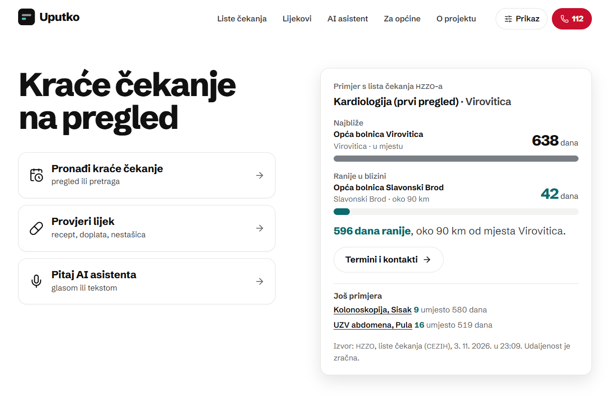

## Problem

Na isti pregled u obližnjoj ustanovi često se čeka mjesecima kraće, ali to je teško saznati. Liste čekanja, popisi ambulanti i podaci o lijekovima postoje, no rasuti su po portalima, a na listama treba ustanovu po ustanovu tražiti. Najteže je onima kojima portali nisu bliski: starijima, slabovidnima i ljudima bez digitalnih vještina.

## Rješenje

Dovoljno je pitati. Uputko pronađe najbližu ustanovu s terminom, kaže postoji li raniji termin u blizini i kako se naručiti.

> **Građanin:** Gdje najprije mogu na MR koljena, blizu Vinkovaca?
>
> **Uputko:** Prema listama čekanja HZZO-a, najbliža ustanova je Opća županijska bolnica Vinkovci: 12. siječnja 2027., za 70 dana. Ranije, za 37 dana umjesto 70, ima Nacionalna memorijalna bolnica Vukovar, oko 17 km: 10. prosinca 2026.

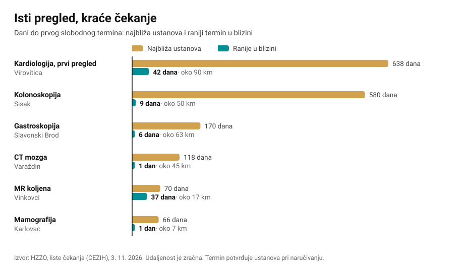

<details>
<summary>Brojke iz grafa</summary>

| Pregled ili pretraga | Mjesto | Najbliža ustanova | Ranije u blizini | Udaljenost |
|---|---|---|---|---|
| Kardiologija, prvi pregled | Virovitica | 638 dana | 42 dana | oko 90 km |
| Kolonoskopija | Sisak | 580 dana | 9 dana | oko 50 km |
| Gastroskopija | Slavonski Brod | 170 dana | 6 dana | oko 63 km |
| CT mozga | Varaždin | 118 dana | 1 dan | oko 45 km |
| MR koljena | Vinkovci | 70 dana | 37 dana | oko 17 km |
| Mamografija | Karlovac | 66 dana | 1 dan | oko 7 km |

Liste čekanja HZZO-a (CEZIH), 3. 11. 2026. Termin potvrđuje ustanova pri naručivanju.

</details>

## Što Uputko radi

### Kraće čekanje

Upišete pregled i mjesto, a naslov odmah kaže koliko možete uštedjeti. Ispod su telefoni ustanova, upute „Kako se naručiti?” i sve ustanove s listom. Odgovor se može ispisati ili poslati poveznicom.

| Na računalu | Na mobitelu |
|---|---|
| 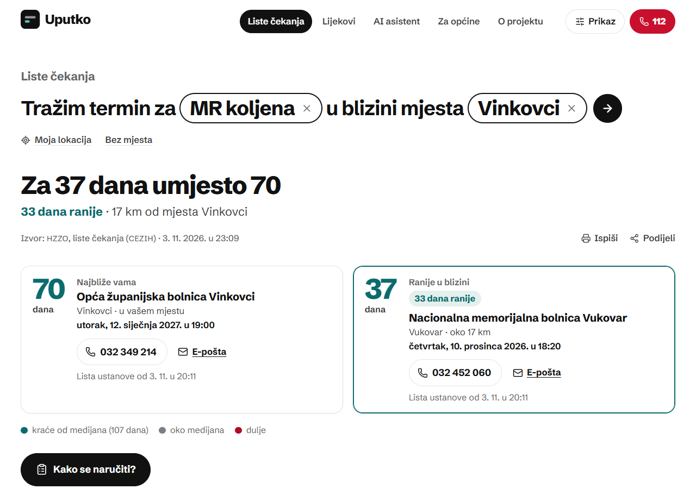 | 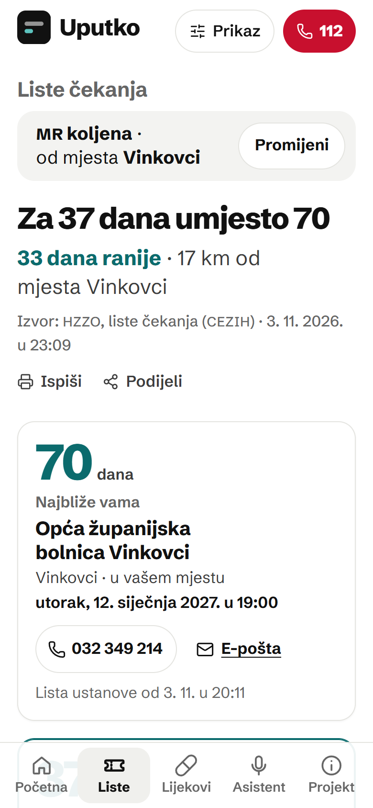 |

### Razgovor glasom ili tekstom

Asistent odgovara kratko i neutralno, a isti odgovor odmah se pojavi na ekranu, s telefonom, izvorom i datumom. Kod hitnih slučajeva odmah upućuje na 112. Ne postavlja dijagnoze i ne savjetuje o lijekovima, a na pitanja izvan zdravstva ne odgovara.

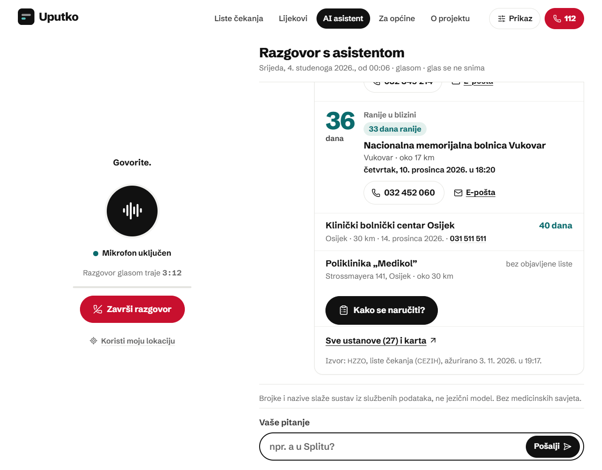

### Provjera lijeka

Djelatna tvar, treba li recept, je li lijek na osnovnoj ili dopunskoj listi HZZO-a i kolika je doplata, je li u prometu ili u nestašici te poveznica na uputu o lijeku.

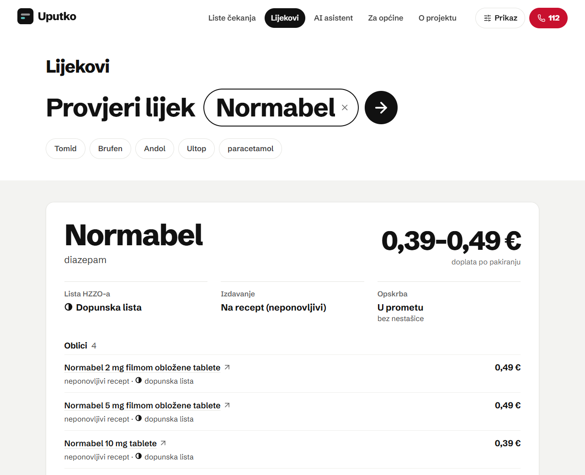

### Za općine i županije

Gdje je više starijih, a manje ordinacija, gdje se najdulje čeka i što građani pitaju, a na što asistent nema odgovor.

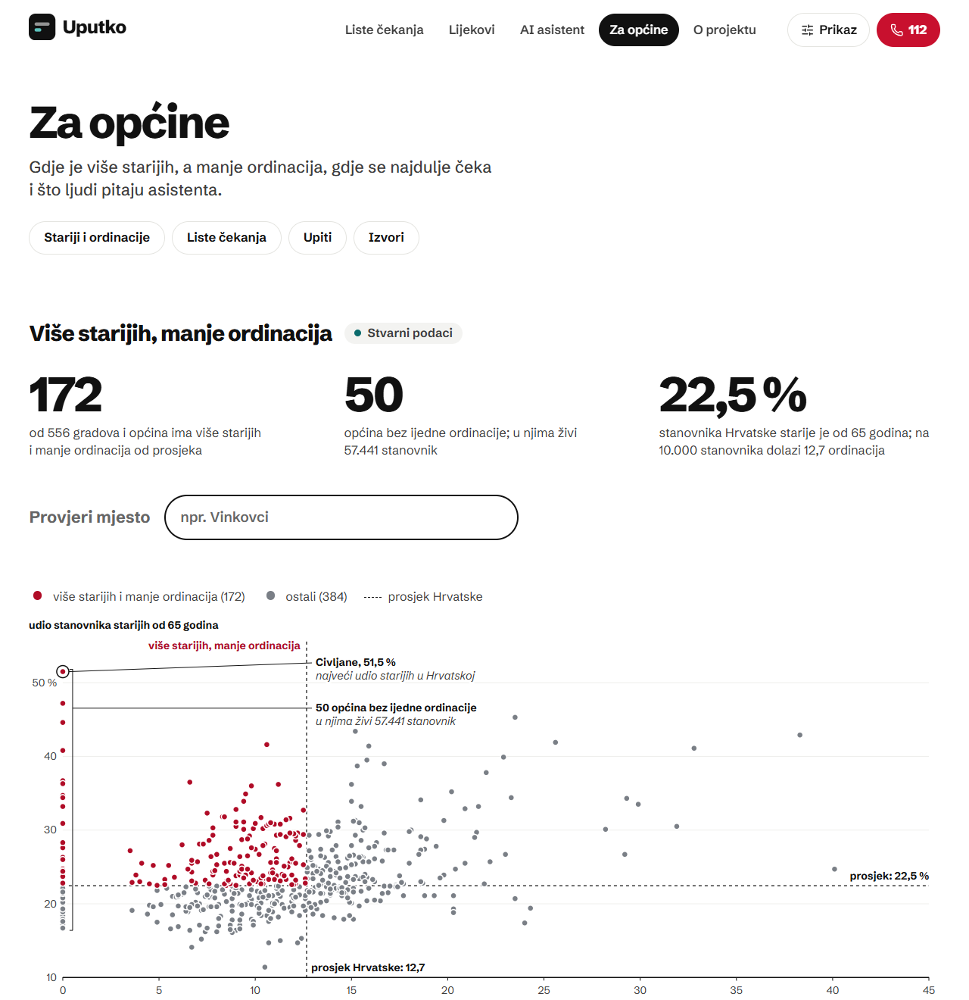

| Čekanje po županijama | Bliže ili ranije? |
|---|---|
| 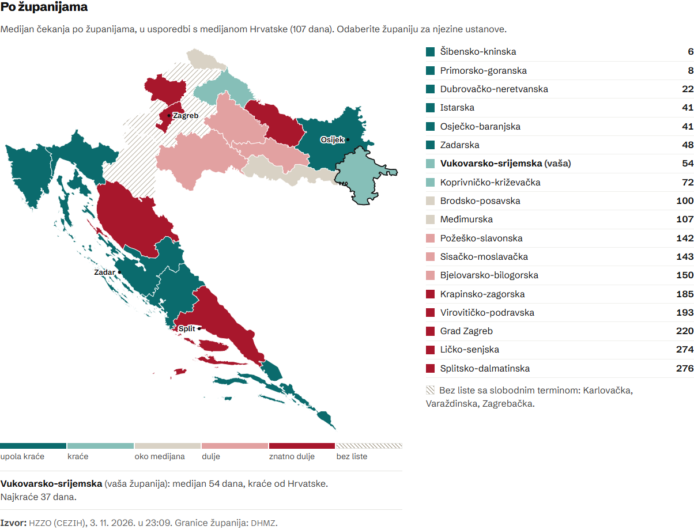 | 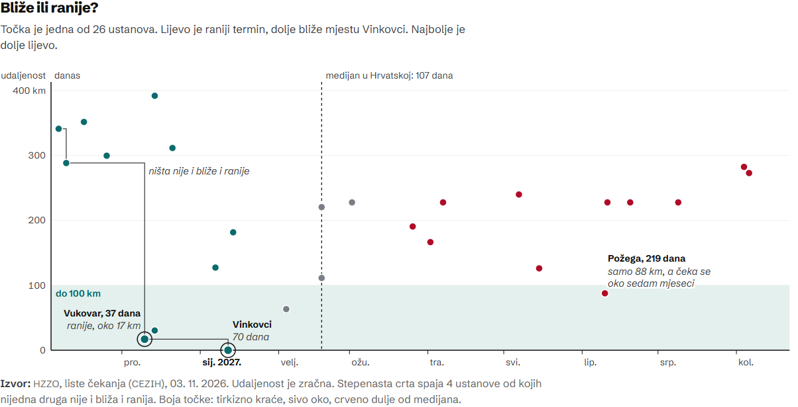 |

### Pristupačnost

Veliki gumbi, tri veličine teksta, visoki kontrast, tamna tema, smanjene animacije i potpuna upotreba tipkovnicom. Provjereno alatom axe-core (WCAG 2.2 A i AA) na svim stranicama, bez nalaza. Bez vodoravnog pomicanja od 320 px naviše.

## Kako nastaje odgovor

Termine, datume i doplate **ne smišlja jezični model**. Asistent samo razumije pitanje i zove alat, a backend brojke i rečenicu slaže iz lokalne kopije službenih podataka.

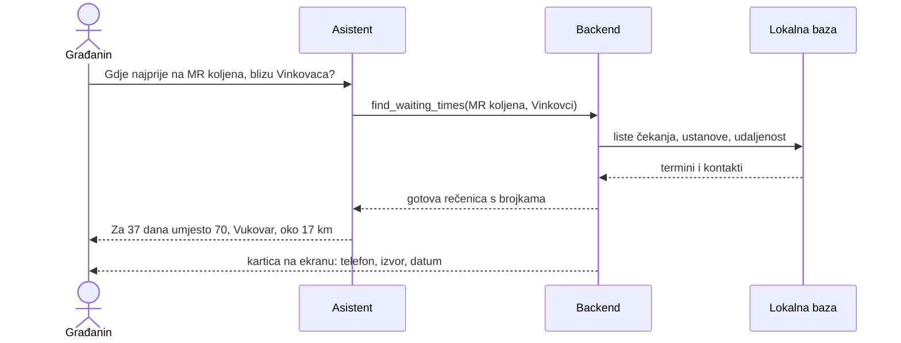

Alati čitaju samo lokalnu bazu, pa odgovaraju za nekoliko desetaka milisekundi i ne ovise o tome radi li izvor u trenutku razgovora. Ako izvor ne odgovori, stari podaci ostaju, a odgovor kaže od kada su.

## Arhitektura

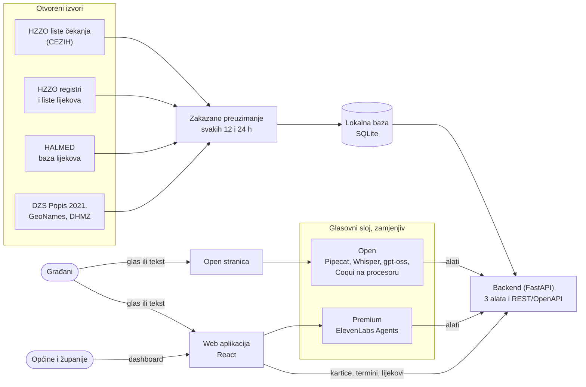

**Tri alata**, isti u oba profila (`agent/tools.schema.json`):

| Alat | Što vraća | Podaci |
|---|---|---|
| `find_waiting_times` | najbliži i raniji termin, ušteda, kontakti, ustanove bez liste | HZZO liste čekanja, registri, naselja |
| `find_health_facilities` | najbliže ordinacije i bolnice s adresom | registri HZZO-a 2026. |
| `get_drug_info` | djelatna tvar, recept, lista HZZO-a, doplata, nestašica | HALMED, liste lijekova HZZO-a |

### Dva profila

Oba koriste isti backend, iste alate i iste podatke. Razlikuje se samo glasovni sloj.

| | Premium | Open |
|---|---|---|
| Namjena | javna stranica i video | potpuno otvoren kod, pokreće se prema uputama |
| Orkestracija razgovora | ElevenLabs Agents | Pipecat (BSD-2-Clause) |
| Prepoznavanje govora | ElevenLabs | Whisper: na Groqu ili lokalno (faster-whisper) |
| Jezični model | po izboru u ElevenLabsu | gpt-oss na Groqu ili lokalno qwen3 u Ollami |
| Sinteza govora | ElevenLabs, hrvatski glas | Coqui VITS za hrvatski, na procesoru |
| Vanjski servisi | ElevenLabs | Groq, ili nijedan u lokalnom načinu |

### Tehnologije

Python 3.12 · FastAPI · SQLAlchemy + SQLite · APScheduler · httpx · lxml · openpyxl · rapidfuzz · shapely · React 19 + TypeScript (Vite) · TanStack Query · `@elevenlabs/react` · Pipecat (WebRTC, RTVI) · Coqui TTS · Docker Compose · Caddy

Standardi: REST + OpenAPI (`/docs`, `/openapi.json`), ATK klasifikacija lijekova, WebRTC, SSE, WCAG 2.2.

## Podaci

| Izvor | Podaci | Zapisa | Osvježavanje | Licenca |
|---|---|---|---|---|
| [HZZO, liste čekanja](https://liste.cezih.hr) (CEZIH) | prvi slobodni termini po postupku i ustanovi | oko 10.900 | svakih 12 h | javna informacija, uz navođenje HZZO-a |
| [HZZO](https://hzzo.hr) | ordinacije primarne zaštite, specijalistička zaštita, bolnice | oko 5.400 | dnevno | javna informacija, uz navođenje HZZO-a |
| [HZZO](https://hzzo.hr) | osnovna i dopunska lista lijekova | oko 4.800 | dnevno | javna informacija, uz navođenje HZZO-a |
| [HALMED](https://www.halmed.hr) / data.gov.hr | svi odobreni lijekovi, izdavanje, status, nestašice | oko 6.400 | svaka 2–3 dana | Otvorena dozvola |
| [DZS](https://podaci.dzs.hr) / data.gov.hr | Popis 2021.: naselja, općine, stanovnici 65+ | 6.757 naselja, 556 općina | jednokratno | Otvorena dozvola |
| [GeoNames](https://www.geonames.org) | koordinate naselja | | jednokratno | CC BY 4.0 |
| [DHMZ](https://meteo.hr) | granice županija, za kartu | 21 | jednokratno | Otvorena dozvola, uz navođenje DHMZ-a |

**Kako se podaci povezuju:**

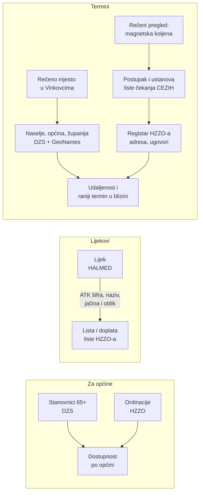

### Što smo našli o kvaliteti podataka

- Liste čekanja nemaju API, preuzimanje ni povijest, a ustanove su navedene skraćenim nazivima bez šifre iz registra HZZO-a. Prijedlog: uz listu objaviti šifru ustanove.
- Skupovi HZZO-a na portalu upućuju na popise iz 2018. i 2013. i na stranice koje vraćaju 404. Aktualni popisi su samo na hzzo.hr, a nazivi datoteka mijenjaju se svaki mjesec.
- HALMED-ova „Baza lijekova” na portalu je stranica tražilice, a ne datoteka; izvoz traži slanje obrasca. Stranica ne odgovara adresama nekih poslužitelja u oblaku.
- „Popis dežurnih ljekarni u RH” zadnji je put ažuriran u ožujku 2023., pa se ne koristi.
- DGU upravne jedinice objavljuje samo kao WMS (slike), bez otvorenog vektorskog skupa naselja.
- DZS u dvije tablice istog Popisa isti JLS piše različito („Hum na Sutli” i „Hum Na Sutli”), a tablice nemaju šifre naselja.

## Pokretanje

Repozitorij sadrži snimku baze (`backend/snapshot/uputko.db.gz`, oko 3 MB), pa aplikacija odgovara odmah, a zatim sama osvježava izvore. Ključevi se upisuju samo u `.env`, koji se nikad ne šalje u repozitorij.

```bash
git clone https://github.com/egi03/uputko.git
cd uputko
cp .env.example .env
```

### Premium: poslužitelj s HTTPS-om

Treba Docker i domena koja pokazuje na poslužitelj. U `.env` upišite `TOOL_SECRET`, `ELEVENLABS_API_KEY`, `ELEVENLABS_AGENT_ID`, `DOMAIN`, `VITE_PUBLIC_URL`, `FRONTEND_ORIGIN` i `PUBLIC_BASE_URL`.

```bash
docker compose --env-file .env -f deploy/docker-compose.yml --profile premium up -d --build
```

`--env-file .env` je obavezan: bez njega Caddy ne vidi domenu i radi samo na HTTP-u, a preglednik tada ne dopušta mikrofon.

Alate, prompt, End call i postavke privatnosti agentu postavlja jedna naredba:

```bash
cd backend
uv sync
uv run python scripts/elevenlabs_tools.py --apply --prompt
```

**HALMED na poslužitelju u oblaku:** ako mu HALMED ne odgovara, u `.env` stavite `HALMED_DOWNLOAD=false`. Bazu lijekova tada šalje računalo kojem HALMED odgovara:

```bash
cd backend
uv run python scripts/push_halmed.py korisnik@poslužitelj
```

### Premium: lokalno

Treba Python 3.12 s [uv](https://docs.astral.sh/uv/), Node.js 22+ i ElevenLabs račun.

```bash
cd backend && uv sync && uv run uvicorn app.main:app --port 8000
cd frontend && npm install && npm run dev        # http://localhost:5173
```

Da agent može zvati alate na vašem računalu, treba javni URL: `cloudflared tunnel --url http://localhost:8000`. Taj URL upišite u `PUBLIC_BASE_URL` i ponovite `elevenlabs_tools.py --apply --prompt`.

### Open: s Groqom, u Dockeru

U `.env` upišite `TOOL_SECRET` i `GROQ_API_KEY`.

```bash
docker compose --env-file .env -f deploy/docker-compose.yml --profile open up --build
# http://localhost:7860
```

Prvo pokretanje preuzima model za sintezu govora. Na Docker Desktopu uključite Settings → Resources → Network → **Enable host networking**.

### Open: sve lokalno, bez vanjskih servisa

Treba NVIDIA grafička kartica s barem 12 GB memorije i [Ollama](https://ollama.com). Glas i tekst ne izlaze s računala.

```bash
ollama pull qwen3:8b
# u .env: OPEN_MODE=local
cd backend && uv sync && uv run uvicorn app.main:app --port 8000
cd open && uv sync --group tts --group local
uv run --group tts --group local python -m bot.main     # http://localhost:7860
```

### Struktura

```
backend/   FastAPI, preuzimanje podataka, alati (/tools), REST za sučelja
frontend/  React aplikacija
open/      Pipecat bot i jednostavna stranica
agent/     prompt, prva poruka i ugovor alata za oba profila
deploy/    Docker Compose i Caddy
```

## Privatnost i sigurnost

- Na vlastitom poslužitelju ne spremaju se snimke, transkripti ni IP adrese. Statistika sadrži samo alat, temu, naselje, općinu, županiju, profil, vrijeme, ishod i trajanje odgovora.
- Lokacija iz preglednika koristi se samo uz dopuštenje i odmah se svodi na naselje.
- Kartice odgovora brišu se nakon 24 sata.
- Imena liječnika i nazivi privatnih ordinacija (sadrže ime liječnika) ne spremaju se.
- **Premium:** glas i tekst obrađuju ElevenLabs i jezični model, s prijenosom u SAD. Agent ne snima glas, a zapis razgovora briše se odmah nakon završetka. Cijela obavijest: [uputko.eugensedlar.com/privatnost](https://uputko.eugensedlar.com/privatnost).
- **Open:** glas i tekst obrađuje Groq, koji prema [svojoj dokumentaciji](https://console.groq.com/docs/your-data) po zadanom ne čuva podatke zahtjeva, osim privremenih logova do 30 dana; njih isključuje Zero Data Retention. U lokalnom načinu ništa ne izlazi s računala.
- Alati su zaštićeni tajnim ključem. Ključevi nikad ne idu u preglednik ni u repozitorij.

## Trošak rada kao javne usluge

Pretpostavke: 10.000 razgovora mjesečno, 2 minute po razgovoru. Cijene iz listopada 2026., 1 $ ≈ 0,87 €.

| | Premium | Open (Groq) | Open na vlastitom poslužitelju |
|---|---|---|---|
| Glasovni sloj | oko 1.390 €/mj + jezični model | oko 20–50 €/mj | uključeno u poslužitelj |
| Poslužitelj | VPS za backend | VPS za backend i sintezu govora | poslužitelj s grafičkom karticom |
| Po razgovoru | oko 0,14 € | oko 0,002–0,005 € + poslužitelj | fiksni mjesečni trošak |

Kapacitet poslužitelja treba izmjeriti prije produkcije.

## Uklapanje u javne sustave

MPUDT je u lipnju 2026. na gov.hr pokrenuo AI asistenta u sklopu Jedinstvenog kontaktnog centra. On odgovara o e-uslugama i propisima. Uputko ga ne zamjenjuje nego nadopunjuje:

- pokriva podatke koji se mijenjaju svaki dan i upite vezane uz lokaciju;
- dodaje glasovni kanal, a kasnije i telefonski;
- alati su REST s OpenAPI opisom, pa ih mogu pozivati i asistent na gov.hr ili kontaktni centar;
- za osobne dokumente, e-Građane i poreze upućuje na gov.hr.

**Preduvjeti za uvođenje:**

- **Tehnički:** poslužitelj s Dockerom i domenom; upozorenje timu kad izvor ima grešku; sigurnosna kopija baze zbog dnevnih snimki lista.
- **Organizacijski:** vlasnik usluge; dogovor s HZZO-om o strojno čitljivim listama sa šifrom ustanove i stalnim URL-ovima te s HALMED-om o stalnom URL-u izvoza.
- **Pravni:** usluga u javnom interesu (čl. 6. st. 1. t. (e) GDPR-a); ugovori o obradi s ElevenLabsom ili Groqom i provjera prijenosa podataka izvan EU-a; procjena učinka (DPIA), jer se obrađuje glas i zdravstvene teme. Open profil omogućuje rad modela na državnoj infrastrukturi, bez vanjskih obrađivača.

## Ograničenja

- Liste čekanja objavljuju same ustanove. Prikazani termin nije rezervacija: potvrđuje ga ustanova pri naručivanju.
- Lokacije ustanova poznate su do razine naselja, a udaljenost je zračna. Privatne ordinacije s lista nemaju lokaciju, jer se ime liječnika ne sprema.
- Trend čekanja raste dan po dan od 27. 10. 2026., jer portal ne čuva povijest.
- Prepoznavanje govora ovisi o buci i dijalektu. Hrvatska sinteza govora u open-source modelima zvuči lošije od komercijalne.
- U pregledniku razgovor glasom počinje jednim pritiskom i dopuštenjem mikrofona; potpuno glasovno korištenje omogućio bi telefonski kanal.

## Daljnji razvoj

- obavijest kad se u blizini oslobodi raniji termin
- telefonski kanal: poziv na običan broj
- modeli open profila na državnoj infrastrukturi
- bolji hrvatski glas za open profil
- dežurne ljekarne, čim izvor bude ažuran
- povezivanje s AI asistentom na gov.hr

## Usklađenost s kriterijima

| Kriterij | Kako ga Uputko ispunjava |
|---|---|
| Upotreba otvorenih podataka | izvori se automatski preuzimaju: CEZIH, HZZO, HALMED, DZS, data.gov.hr |
| Povezivanje podataka | mjesto iz govora → naselje → općina → županija; liste čekanja → registar HZZO-a; HALMED ↔ liste lijekova; DZS × HZZO po općini |
| Relevantnost | pristup zdravstvenoj zaštiti: termini, ambulante, lijekovi, pristupačnost |
| Utjecaj i korist | na jedno pitanje gdje se najkraće čeka; općine vide gdje je više starijih, a manje ordinacija |
| Inovativnost | glasovni agent koji u stvarnom vremenu koristi alate nad otvorenim podacima; brojke iz predložaka, ne iz jezičnog modela |
| Izvedivost | radni prototip na javnom linku; open profil pokreće se jednom naredbom |
| Arhitektura i integracija | modularni alati, REST/OpenAPI, dva zamjenjiva glasovna sloja, uklapanje uz asistenta na gov.hr |
| Dojam (UI/UX) | tri jasna zadatka, ušteda kao naslov rezultata, „Kako se naručiti?” uz svaki termin, pristupačno uz čitač zaslona |
| Softver otvorenog koda | kod pod EUPL-1.2; open profil koristi samo open-source softver i open-weight modele |

## Licenca i atribucija

- **Kod:** [EUPL-1.2](LICENSE).
- **Podaci:** HZZO (liste čekanja, registri, liste lijekova): javna informacija, slobodno citiranje uz navođenje izvora, bez komercijalne uporabe. HALMED i DZS pod Otvorenom dozvolom. DHMZ (granice županija), uz navođenje izvora. [GeoNames](https://www.geonames.org), CC BY 4.0. Snimka baze u `backend/snapshot/` sadrži podatke iz tih izvora i za nju vrijede njihovi uvjeti.
- **Komponente:** Pipecat (BSD-2-Clause), Whisper (MIT), gpt-oss (Apache 2.0), coqui-tts (MPL-2.0), Coqui VITS za hrvatski (BSD-3-Clause, autor Neon Gecko), Silero VAD (MIT), Lucide ikone (ISC), Schibsted Grotesk (SIL OFL).
